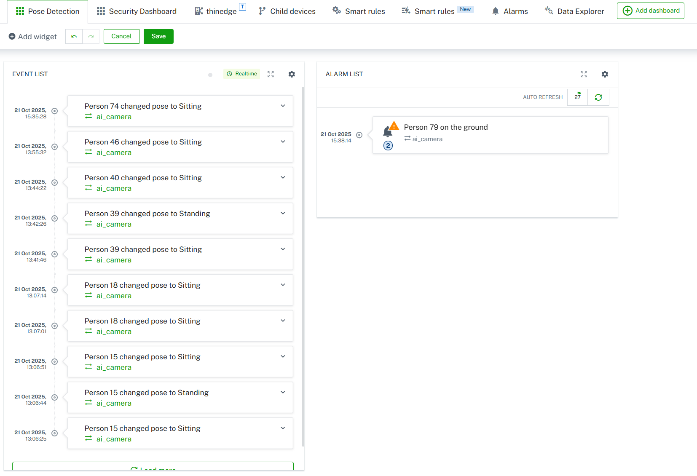

# Pose Detection AI App

This demo shows how you can use Vision AI to help people that are e.g. alone in an area in case of an emergency. The camera sends messages to Cumulocity in case it detects people lying on the floor for a period of time, indicating a person in need.


## 🤖 Model

The model for this demo is a pose detection model based on Ultralytics Yolo 11. The model used is the **"ultralytics-pose.zip"**.

## 📈 The Data

### Data of the camera

The AI application will track persons while they are in the FoV and use the calculated keypoints to estimate a current pose (Lying, Standing, Sitting). When an person has the same pose  for ~5 seconds an event with the last pose of the person will be sent to Cumulocity. If the person is Lying, an alarm will be raised instead.

## 🖼️ Example Dashboard




## 📦 Debian Package Build

In case you modified the script here is a short guide how to build the debian again.

### Prerequisites

* The `dpkg-deb` utility

### Steps

    From the directory of this README run the following command:
    ```bash
    dpkg-deb --build pose-detection
    ```
    This will create a `pose-detection.deb` file in the current directory.

## ☁️ App Installation

Once you have the Debian package, you can follow the steps from the main README to install the AI application again.